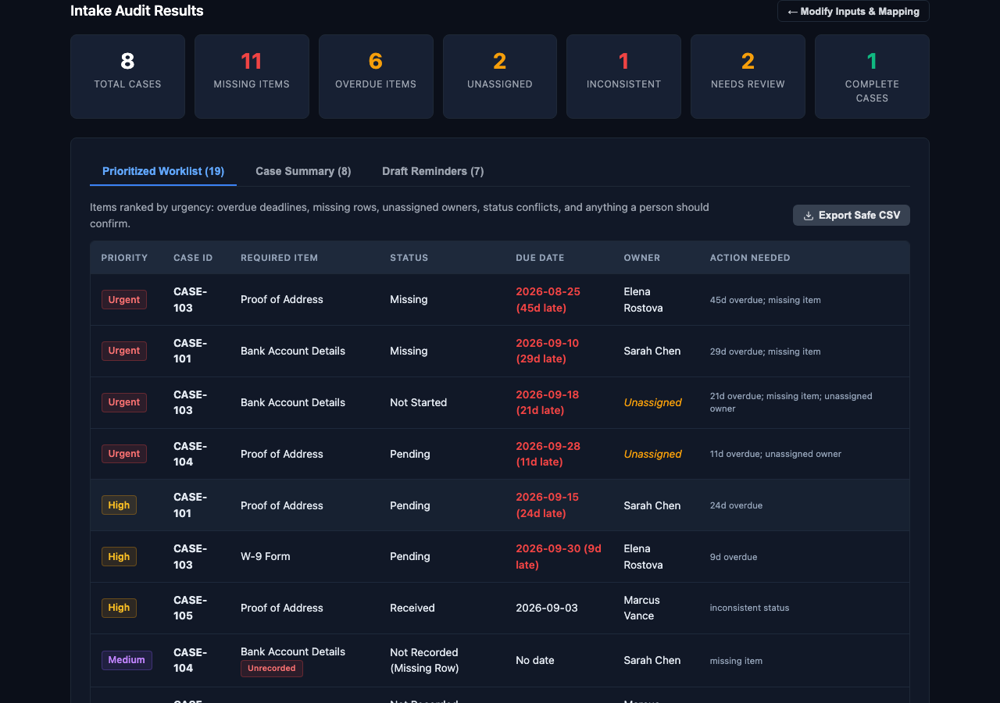

# Client Intake Gap Finder

**Live tool: https://www.nodestar.ai/tools/intake-gap-finder**



A lightweight, browser-based operations utility for RIAs, accounting firms, insurance agencies, and client service teams to audit client onboarding trackers, catch missing documents, flag overdue requirements, and identify unassigned cases.

## Problem

Client onboarding trackers often suffer from silent failure modes:
1. **Silent missing items**: Trackers that only log received documents make incomplete cases look finished because missing rows are invisible.
2. **Conflicting statuses**: Duplicate rows or updates leave contradictory statuses (e.g., received vs missing).
3. **Unowned tasks and overdue deadlines**: Critical onboarding milestones slip because no single lead is assigned.
4. **Formula injection risks**: Exporting operational worklists to spreadsheets can expose teams to CSV injection attacks.

## How It Works

1. **Import Tracker CSV**: Upload any CSV export from your CRM, Google Sheets, Airtable, or internal database. Alternatively, click "Load Synthetic Demo Data" to test immediately.
2. **Map Columns**: Select your tracker columns for Case Reference, Required Item, Status, Due Date, and Case Lead.
3. **Master Checklist Detection**: Provide an optional master required checklist. If an intake case has zero rows for a required item, the tool flags it as an unrecorded missing item rather than assuming completion. Names match loosely (case, punctuation, hyphens, "form" and "copy" suffixes, plurals), so "W-9" counts as "W-9 Form". A possible match, such as "Photo ID" for "Government Photo ID", is never decided for you: it goes to Needs Review.
4. **Prioritized Worklist**: Review items categorized by explicit rule-based urgency (Urgent, High, Medium, Review, Low) based on overdue days and gap type. Common statuses (Uploaded, Signed, Submitted, Received, Approved, N/A and more) are understood in any case or spacing. A status the tool does not know becomes Needs Review instead of a false alarm. "Under Review" and "Sent" do not say the client still owes the item, so they stay on the worklist but are never put in a client email. If you leave the status column unmapped, every listed row counts as received and only checklist gaps are flagged.
5. **Draft Reminders**: Copy pre-drafted client follow-up copy tailored to the exact missing items per case. A draft only asks for items that are confirmed outstanding. Anything that needs review or has contradictory rows stays on the worklist for your team and is left out of client emails.
6. **Safe CSV Export**: Export the prioritized worklist with automatic formula injection protection (prefixes cells starting with `=, +, -, @` with single quotes).

## Privacy

- All parsing and analysis run in your browser. No file content, client names, or case IDs are sent to any server.
- Optional email summary (hosted page only): on nodestar.ai a form can email you a counts-only summary (cases, missing, overdue, unowned). It sends only the address you type and those counts, never client names or rows, and only when you press the button. Opened from a file, the form does not exist.
- Opened from a file, the page contacts no server and works offline.

## Architecture

- `index.html`: Responsive, zero-dependency single-page interface.
- `logic.js`: Universal JavaScript engine (browser and Node.js compatible).
- `test.js`: Automated test suite covering edge cases and failure modes, including the 2026-10-09 audit regressions.
- `fixtures/wealth-advisor-tracker.csv`: Realistic 11-row, 3-client tracker used by the tests and the browser check.
- `demo-data.csv`: Synthetic demo dataset for testing.

## How to Run

Open `index.html` in any browser (keep `logic.js` next to it), or use the live tool linked above. Click "Load Synthetic Demo Data" to see it work without your own file.

## Running Tests

Requires Node 18 or later. There are no dependencies to install.

```bash
node test.js
```

## Commercial Integration

This lead magnet finds intake gaps once. For firms that want the follow-up handled for them, the page links to [Invoice Chase](https://www.nodestar.ai/installs/invoice-chase?utm_source=tool&utm_medium=lead-magnet&utm_campaign=intake-gap-finder), NodeStar's follow-up install.

## License

MIT (c) 2026 NodeStar. See [LICENSE](LICENSE) for details.
